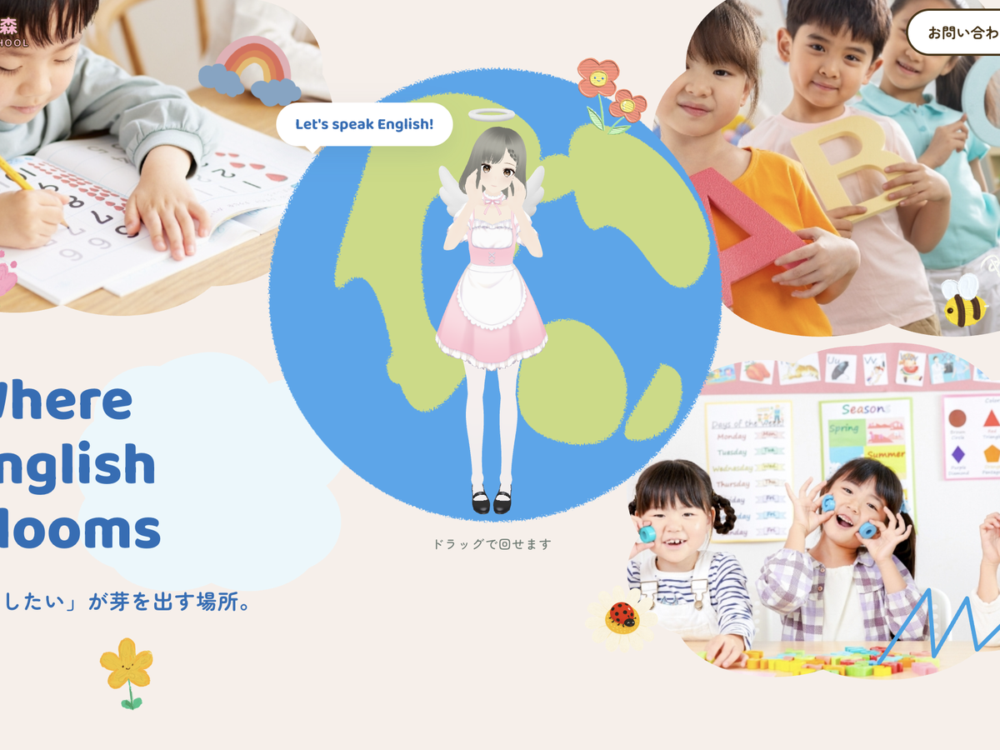

# うさぎの森 えいごスクール — WordPress オリジナルテーマ

キッズ英会話スクール「うさぎの森 えいごスクール」（架空のスクール）のために制作した、WordPress のオリジナルテーマです。
静的 HTML で制作したサイトを、WordPress テーマへ移植しました。

ポートフォリオ用の制作物です。実在するスクール・団体とは関係ありません。



---

## ブラウザですぐに試す

サーバーを用意せずに、ブラウザの中だけで動かせます。
ポートフォリオサイトの作品ページから「ブラウザでデモを動かす」で開けます。

デモはお知らせ10件と、よくあるご質問19件（8カテゴリ）、
トップ / お知らせ / コース / こだわり / よくあるご質問 / お問い合わせの各ページが
登録済みの状態で起動します。管理画面には `admin` / `password` でログインした状態です。

---

## このテーマでできること

| 管理画面から更新できるもの | 使っている仕組み |
| --- | --- |
| お知らせ（写真・カテゴリ） | WordPress 標準の投稿とカテゴリ |
| よくあるご質問（質問・答え・分類・並び順） | カスタム投稿タイプ `faq` ＋ タクソノミー `faq_category` |
| 各ページの本文 | 固定ページ |

お知らせを1件追加すると、トップページの「イベント＆入会のお知らせ」「最近のできごと」、
お知らせ一覧、カテゴリ別一覧、個別ページのすべてに反映されます。

---

## 主な実装

### 3Dモデルの表示

トップページの先生キャラクターとうさぎは、自作の glb モデルを `model-viewer` で表示しています。
`wp_enqueue_script_module()` を使い、**トップページだけ**で読み込むようにしました。

### ページごとのCSS分割

共通の `style.css` に加えて、固定ページのスラッグに応じて `css/about.css` などを読み込みます。
全ページで全部のCSSを読む作りにしていないので、コース紹介の長いCSSがトップページには届きません。

```php
$page_styles = array( 'about', 'course', 'news', 'faq', 'contact' );
foreach ( $page_styles as $slug ) {
	if ( is_page( $slug ) || ... ) {
		wp_enqueue_style( 'aa5-' . $slug, $theme_uri . '/css/' . $slug . '.css', ... );
	}
}
```

### メールフォームをプラグインなしで実装

お問い合わせフォームは、テーマの中で完結させています。

- `wp_nonce_field()` / `wp_verify_nonce()` による改ざん対策
- 項目ごとの `sanitize_*` と、氏名・メール・電話番号・同意の入力チェック
- 人には見えない入力欄（ハニーポット）による迷惑メール対策
- `wp_mail()` で管理者宛に送信し、`Reply-To` に送信者を入れる
- 送信後は `wp_safe_redirect()` で `?sent=1` へ移動（再読み込みによる二重送信を防ぐ）

### よくあるご質問の自動登録

`aa5_seed_faq()` が、テーマを有効化した最初の1回だけ、
静的HTMLに書いていた質問19件を8カテゴリに分けて登録します。
2回目以降は `aa5_faq_seeded` オプションを見て実行されません。

### そのほか

- `filemtime()` をバージョン番号に使い、CSS / JS のキャッシュが自動で切れるように
- 一覧の1件分を `template-parts/news-item.php` に切り出し、お知らせ一覧・カテゴリ別一覧・検索結果で共通化
- カテゴリの絞り込みと「つづきを見る」は、JavaScript 側で件数を制御

---

## テンプレート構成

```
header.php                  ヘッダーとドロワーメニュー
index.php                   トップページ
page-news.php               お知らせ一覧
page-course.php             コース紹介
page-about.php              うさぎの森のこだわり
page-faq.php                よくあるご質問
page-contact.php            お問い合わせ（フォームの送信処理つき）
single.php                  お知らせ記事
archive.php                 カテゴリ・日付・検索結果の一覧
search.php                  検索（archive.php を読み込む）
404.php                     ページが見つからないとき
footer.php                  フッター
functions.php               テーマ設定・カテゴリ定義・アセット読み込み
inc/faq.php                 よくあるご質問の投稿タイプと初期データ
template-parts/news-item.php お知らせ一覧の1件分
style.css                   共通のスタイル
css/                        ページごとのスタイル
main.js                     ドラワー・絞り込み・スクロール演出
models/                     3Dモデル（rabbit.glb / teacher.glb）
images/                     写真・イラスト・ロゴ
```

---

## 動作環境

- WordPress 6.5 以上（`wp_enqueue_script_module()` を使用）
- PHP 7.4 以上

---

## インストール

1. このリポジトリを ZIP でダウンロードする
2. WordPress の管理画面で「外観 > テーマ > 新規追加 > テーマのアップロード」から ZIP を選ぶ
3. 有効化する（このとき、よくあるご質問が自動で登録されます）
4. 固定ページを `news` / `course` / `about` / `faq` / `contact` のスラッグで作成する
5. 「設定 > 表示設定」でホームページを固定ページに設定する

---

## ライセンス

GNU General Public License v2 or later（[LICENSE](LICENSE)）

写真はフリー素材を使用しています。3Dモデルは自作です。
掲載しているスクール名・住所・電話番号・料金はすべて架空のものです。

---

制作：森本優香里（[helpmark-pink](https://github.com/helpmark-pink)）
